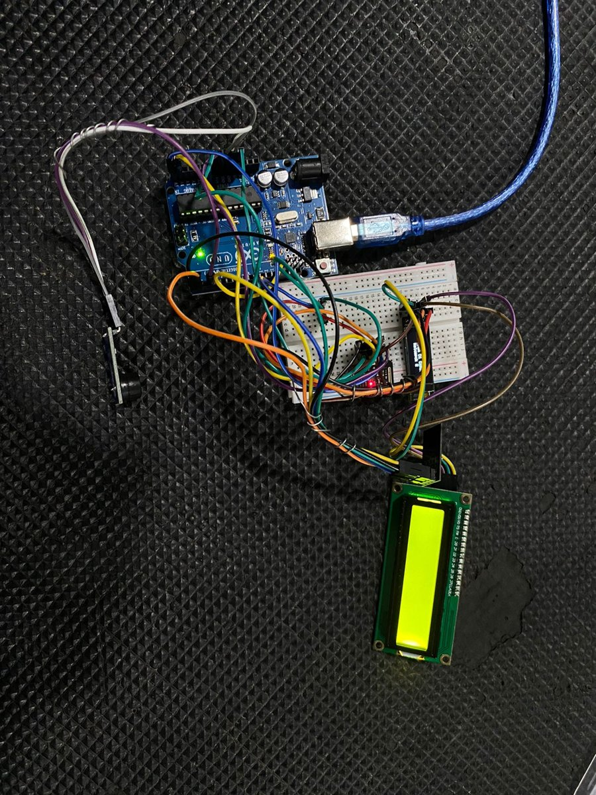
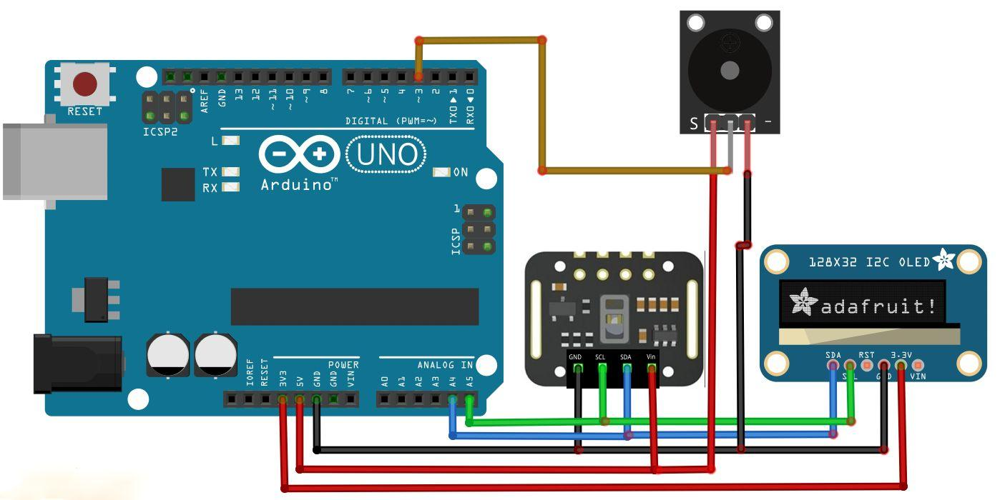
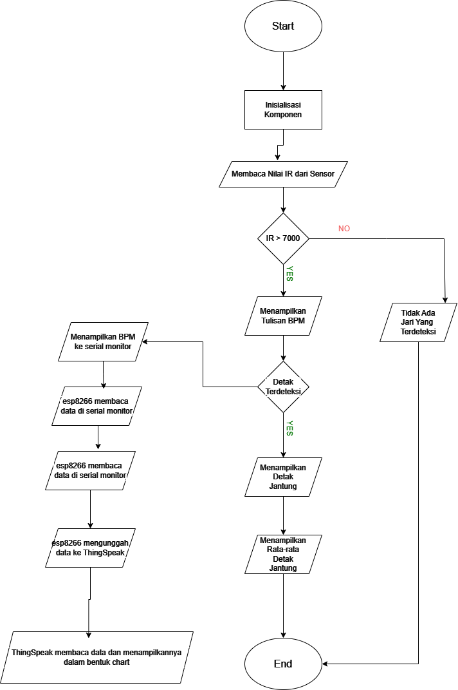

# Alat Pendeteksi Detak Jantung (Arduino Uno + MAX30102)

Proyek kelompok mata kuliah **Mikrokontroler**. Pengguna menempelkan jari pada sensor MAX30102;
detak jantung (BPM) tampil di layar OLED, buzzer berbunyi tiap detak, dan setelah **60 detak valid**
LCD menampilkan rata-rata BPM beserta kategorinya (mis. "Baik").



> **Penting:** ini proyek belajar, **bukan alat medis**. Hasilnya tidak boleh dipakai untuk diagnosis.

## Komponen

| Komponen | Fungsi |
|---|---|
| Arduino Uno | Mikrokontroler |
| Sensor MAX30102 (library MAX30105) | Membaca denyut dari ujung jari (I2C) |
| OLED SSD1306 128x32 (alamat 0x3C) | Menampilkan BPM dan ikon detak |
| LCD I2C 16x2 (alamat 0x27) | Hitung mundur dan hasil rata-rata |
| Modul buzzer | Berbunyi tiap detak (pin **D3**) |
| Breadboard dan kabel jumper | Perakitan |

Sensor, OLED, dan LCD berbagi satu jalur I2C (SDA = A4, SCL = A5 pada Uno), masing-masing dengan alamat
berbeda. Lihat skema di bawah; periksa juga tegangan kerja tiap modul sebelum dinyalakan.

## Cara kerja

1. Sensor dibaca terus-menerus. Nilai IR di atas 7000 berarti ada jari.
2. Tiap detak terdeteksi (`checkForBeat`), selisih waktu dengan detak sebelumnya diubah menjadi BPM.
   Nilai di luar 20-255 BPM dibuang sebagai derau.
3. OLED menampilkan rata-rata bergerak 4 detak terakhir; LCD menghitung mundur 60 detak.
4. Setelah 60 detak valid, LCD menampilkan rata-rata dan kategori selama 2 detik, lalu sesi baru dimulai.
5. Jika jari diangkat, sesi diulang dari awal.

| Blok diagram | Flowchart |
|---|---|
|  |  |

Blok diagram dan flowchart berasal dari rancangan awal yang juga memuat modul Wi-Fi ESP8266 dan
ThingSpeak. **Fitur pengiriman data itu belum aktif di kode ini.**

### Kategori hasil

Memakai tabel denyut istirahat **laki-laki usia 18-25 tahun** dari proposal. Tabel perempuan dan kelompok
usia lain belum diterapkan, jadi kategori untuk pengguna di luar kelompok itu tidak akurat.
Untuk mengubahnya, edit fungsi `bpm::status()` di `detak_jantung/logika_bpm.h`.

| Rata-rata BPM | Tampil di LCD | Istilah pada tabel proposal |
|---|---|---|
| < 49 | Di Bawah Normal | (di luar tabel) |
| 49-55 | Sangat Baik++ | Sangat baik sekali |
| 56-61 | Sangat Baik | Sangat baik |
| 62-85 | Baik | Baik |
| 86-89 | Cukup++ | Lebih dari cukup |
| 90-93 | Cukup | Cukup |
| 94-101 | Kurang Baik | Kurang |
| >= 102 | Buruk | Buruk |

## Menjalankan di Arduino

1. Pasang library lewat Library Manager: **Adafruit GFX Library**, **Adafruit SSD1306**,
   **SparkFun MAX3010x Pulse and Proximity Sensor Library**, **LiquidCrystal I2C**.
2. Buka `detak_jantung/detak_jantung.ino` (file `logika_bpm.h` harus tetap satu folder dengannya).
3. Pilih board **Arduino Uno**, lalu Upload. Serial Monitor (9600 baud) mencetak tiap BPM valid.

## Struktur

```
detak_jantung/
  detak_jantung.ino   sketch utama
  logika_bpm.h        logika murni (kategori, rata-rata, sesi 60 detak)
tests/
  test_logika_bpm.cpp uji logika murni
  simulasi/           simulasi sketch di komputer dengan library palsu (stub)
  jalankan_tes.sh     menjalankan semua uji
docs/                 skema, blok diagram, flowchart, foto rangkaian
```

## Pengujian di komputer

```bash
sh tests/jalankan_tes.sh      # butuh g++
```

- `test_logika_bpm.cpp`: 353 pemeriksaan (batas tiap kategori, filter derau, rata-rata, sesi 60 detak).
- `simulasi/`: menjalankan sketch utuh dengan "library" palsu yang meniru sensor, OLED, LCD, dan buzzer
  (16 pemeriksaan: hitung mundur, hasil 72/100/55 BPM, jari diangkat lalu dipasang lagi, frekuensi OLED).

Batasan: simulasi memakai library palsu buatan sendiri dan detak buatan, jadi **tidak menggantikan uji pada
alat sungguhan**. Sketch ini juga belum dikompilasi dengan toolchain AVR di sini, jadi pemakaian memori
Uno dan kecocokan versi library belum dicek.

## Perbaikan dari versi awal

- Jari diangkat atau sesi selesai: data lama dan waktu detak terakhir di-reset. Sebelumnya detak pertama di
  sesi berikutnya menghasilkan BPM semu (~24 BPM pada simulasi) yang ikut masuk rata-rata.
- OLED tidak lagi digambar ulang di setiap putaran `loop()`, tetapi tiap 100 ms, agar pembacaan sensor
  tidak tertahan transfer layar. Pada simulasi, versi awal memanggil `display()` di setiap putaran.
- `delay(100)` untuk buzzer diganti `tone(pin, frekuensi, durasi)` yang tidak menghentikan program.
- Tujuh blok `else if` yang hampir sama diganti satu fungsi `bpm::status()`.
- "Rata-rata" OLED sebelumnya hanya 1 detak terakhir (`Tekanan = 1`); sekarang rata-rata 4 detak.
- Pesan `Bukan Orang` untuk BPM < 49 diganti `Di Bawah Normal`.
- Pesan "Letakkan Jari" kini tampil juga saat alat baru menyala.
- Teks hitung mundur LCD diberi lebar tetap (`59s`, ` 9s`).
- Kunci API ThingSpeak dan kata sandi Wi-Fi yang tertinggal di komentar kode dihapus.

## Pengembangan lanjutan

- Aktifkan pengiriman data ke ThingSpeak lewat ESP-01 (simpan kunci API di file terpisah yang tidak diunggah).
- Tabel kategori perempuan dan berbagai usia.
- Uji dan kalibrasi pada alat sungguhan (ambang jari, posisi jari, perbandingan dengan alat ukur lain).

## Tim

Dikerjakan oleh Kelompok 2 (Universitas Amikom Yogyakarta):
- Akbar Haqi Nasrullah
- Devananda Fikri Muhammad Rafi
- Muhammad Rafli Rangga Pratama
- Nanda Pratama
- Yuli Dwi Kurniawan.
